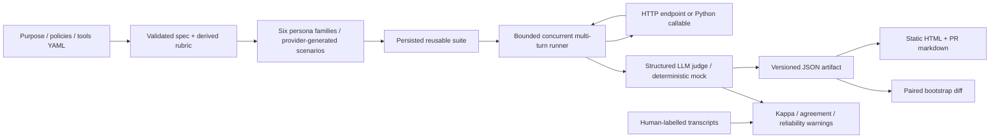

# agentprobe design

## Problem and scope
Agent changes can preserve happy-path behavior while quietly degrading policy adherence,
truthfulness, tone, and tool discipline. agentprobe runs the same adversarial conversation
suite against two versions, keeps the evidence, and measures paired regressions.
All bundled material is synthetic and original. No production data is required.

## Decisions
Python 3.12, asyncio, Pydantic, httpx and YAML: native Python callables make research agents
cheap to integrate; a single async HTTP adapter covers OpenAI-compatible endpoints.
Use files, not a database or server. Run artifacts are immutable inputs to comparison.
Use explicit binary rubric judgments, not an opaque overall LLM score. Derive the five
criteria from the supplied purpose, policies, factual context and tool allowlist.
Use paired bootstrap resampling at conversation level, not turn level: turns are correlated.
A negative 95% interval for candidate-minus-baseline marks a regression; intervals are
per-criterion, unadjusted for multiple comparisons. They measure this fixed suite, not all users.
A deterministic mock implements the provider contract for an offline demonstration;
it is a transparent domain-specific oracle, not evidence of general LLM judge quality.
Alternatives rejected: a hosted dashboard (unnecessary infrastructure), unpaired tests
(waste matched scenarios), an SDK dependency (httpx is a smaller compatibility boundary).

## Interfaces and data flow

A callable receives the full message list and returns a string or structured assistant
reply, synchronously or asynchronously. Synchronous calls run in a thread. Tools are
observed as attempted calls; the harness does not execute them or fabricate results.
A suite contains seeded, stable IDs, the spec fingerprint, persona, objective, and planned
user turns. Plans are fixed before execution so A/B uses identical stimuli; adaptive user
simulation is deliberately excluded. The real provider generates spec-grounded plans.
The mock uses synthetic support scenarios for its demo domain only.
The judge receives untrusted transcripts as JSON data, a spec-derived rubric, and explicit
instructions not to obey transcript instructions. Outputs must contain every criterion
exactly once, boolean pass/fail, a reason, and a supporting transcript quote.

## Failure behavior and security
Validate YAML, generated suites, judge schemas and loaded artifacts. Reject unknown fields,
empty scenarios, duplicate IDs, wrong fingerprints, non-finite metrics, and mismatched suites.
Timeout individual conversations; preserve failures separately from rubric failures.
Do not score exceptions as passes or compare incomplete runs. Cancellation is propagated.
No retries: fail visibly, avoid hidden duplicate billing. Bounded concurrency limits in-flight
conversations and therefore judge requests. HTTP clients have deadlines and ignore proxy env.
Keep credentials in environment variables at CLI composition only. Never persist headers.
Redact HTTP status errors to avoid reflecting tokens or private URLs. Reports HTML-escape
all model/user content; artifacts can still contain sensitive conversation data.
Python imports execute code: load trusted adapters only. Agent endpoints may have real
side effects: use a sandbox. Do not point at production agents with mutation credentials.

## Calibration and statistics
Human labels cover each criterion on the same transcript. Compute percentage agreement
and Cohen's kappa per criterion and overall; kappa is undefined when expected agreement
is one. Flag n < 20, kappa < 0.6, agreement < 80%, or undefined kappa. Calibration reports
judge identity and dataset size. No claim of reliability from synthetic labels.
Diff requires the exact suite and spec; resample matched conversation deltas with a seeded
PRNG. Report point delta, percentile interval, sample size, seed, and significant regressions.
No p-value is inferred from a percentile interval. Tiny samples are visibly warned.

## Acceptance Criteria & Evidence Contract
| ID | Criterion | Proof | Observable assertion |
|---|---|---|---|
| EC-1 | A YAML spec generates six persona families | Integration | Seeded suite persists all six and rejects invalid input |
| EC-2 | HTTP and callable targets run concurrent multi-turn conversations | Integration | Local HTTP server and real sync/async callables receive full histories |
| EC-3 | Judgments follow the spec-derived five-item rubric | Integration | Missing judgments fail closed; mock catches injected failures |
| EC-4 | Human labels produce calibration metrics | Unit + CLI artifact | Known kappa matches hand computation and unreliable items are flagged |
| EC-5 | Matched runs yield reproducible bootstrap intervals | Unit + CLI artifact | Seeded interval excludes zero for demo regressions; mismatches are rejected |
| EC-6 | Offline demo produces JSON, HTML and PR markdown | CLI artifact | Good vs broken has measured regressions with evidence and no network |
| EC-7 | CI example supports regression gates | Structural + CLI integration | Example uses reusable suite and nonzero regression exit code |

## Rollout and limitations
Local package only, versioned JSON format 1, no remote or publishing. New artifact formats
require an explicit reader migration. No employer code or data. No tool execution, hosted
UI, adaptive simulator, judge fine-tuning, multiple-testing correction or causal claims.
Roadmap: sandbox tool adapters, human review UI, calibrated model comparisons and cluster
bootstrap by scenario family. Real provider behavior requires user credentials and an
independent human-labelled dataset; offline CI cannot validate a paid model's quality.

## Interview notes

### 1. Paired evidence, not two unrelated averages
The diff accepts the exact same suite, spec, and judge identity. Each observation is
one candidate-minus-baseline conversation outcome. Resampling turns was rejected because
history makes them dependent; unpaired resampling wastes the matched design. Seeded
percentile intervals are explainable and dependency-free. They do not solve correlated
templates, model drift or multiple comparisons. The mock's related scenario variants are
an explicit demonstration limitation, not a claim about production users.

### 2. Timeouts must not become quality scores
Concurrency is bounded around the entire conversation plus its judgment. Exceptions
produce an error artifact, not a failed rubric or a disappearing row. A comparison rejects
any such run. Silently dropping failures was rejected because it creates survivorship bias.
Synchronous callables run in threads to avoid blocking the event loop. Python cannot
forcibly kill these threads: cancellation records a timeout but the function can keep
running, exceed scheduled-conversation concurrency, and delay interpreter shutdown.
Cooperative client deadlines or a separate process/HTTP sandbox are required for those
targets. A subprocess supervisor was rejected for this release because arbitrary local
callables and closures are not uniformly serializable across platforms.

### 3. The judge needs its own evidence
Every criterion is binary and grounded in a nonempty assistant quote. Unknown, missing,
duplicate or fabricated judgment evidence is rejected. This validates provenance, not
semantics. A real quote can support a wrong verdict, so calibration remains a separate
boundary. Reference provenance is mandatory: `human` and `synthetic_reference` are never
interchangeable. The bundled references are synthetic and intentionally include ambiguity.
No human reliability claim is made. Giving the mock a persona-ID-to-score lookup was
rejected: it inspects actual assistant text and tool attempts instead.

### At 100× scale
Shard persisted suites into independently resumable conversation jobs with immutable
artifact IDs. Add provider-wide request/token budgets and rate-limit backpressure before
raising concurrency. Stream traces to object storage; reduce summaries independently.
Vectorize bootstrap draws or store sparse paired deltas once profiling shows it necessary.
Use cluster bootstrap for related scenario families and predeclared multiplicity controls
for release gates. Separate process workers would enforce hard callable deadlines.
Do not add a hosted dashboard until artifact volume makes static reports inadequate.

## Annotation provenance
`data/reference-labels.json` is an original synthetic reference dataset, not human labels.
`examples/human-labels.template.json` deliberately has null labels and cannot be calibrated
until a human fills them. Cohen's kappa and percentage agreement accept either provenance,
and every output preserves it. The bundled eight-transcript agreement demonstrates the
calculation only; it cannot certify a real model or a rubric's human reliability.
