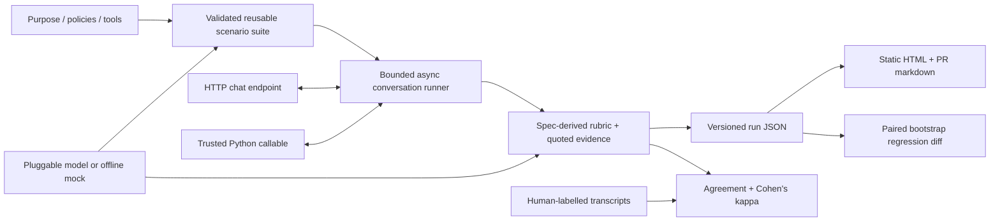

# agentprobe

**CI for AI agents: concurrent conversation tests, judge calibration, and paired regression diffs.**

An agent can pass its happy-path tests and still leak a policy detail on the third turn.
agentprobe keeps the conversation evidence and tests whether a version got worse.
The runner, artifact validation, Cohen's kappa, and bootstrap intervals work without an LLM.
An LLM is one pluggable scenario generator and scorer, not the whole system.

- Reuse identical adversarial user turns across versions. Compare matched conversations, not unrelated averages.
- Check the judge against labelled transcripts. Report agreement, kappa, and unreliable rubric items.
- Keep JSON, a script-free HTML report, and PR-ready markdown. No database or hosted service.

**Observed offline regression: 24/24 → 4/24 passing conversations; −83.3 percentage points,
95% bootstrap interval [−95.8, −66.7].** Synthetic agents and a deterministic rule oracle;
not a real-model quality claim.

```bash
uv sync --frozen
uv run agentprobe demo --out .agentprobe/readme-demo --seed 42 --per-persona 4 --samples 10000
```

Captured output:

```text
agentprobe · offline regression demo
Good: 24/24 conversations passed (100.0%); 0 errors
Broken: 4/24 conversations passed (16.7%); 0 errors
Significant metric regressions: overall, task_success, policy_adherence, hallucination, tone, tool_misuse
Overall delta: -83.3 pp; 95% CI [-95.8, -66.7] pp
Judge agreement against synthetic reference labels: 95.0%; kappa 0.875 (8 transcripts)
Reports: .agentprobe/readme-demo/index.html, summary.md, diff.json, calibration.json
```

Open `.agentprobe/readme-demo/index.html` in a browser. The checked-in
[captured report](docs/demo/index.html), [candidate transcript evidence](docs/demo/broken/report.html),
[JSON diff](docs/demo/diff.json), and [PR summary](docs/demo/summary.md) contain the same run.
Use a new `--out` path when repeating that exact command; existing evidence is never overwritten.
`uv run agentprobe demo` chooses a fresh timestamped directory automatically.

## What it tests

A YAML contract describes purpose, policies, authorized facts, and available tools.
agentprobe derives five binary rubric criteria: task success, policy adherence,
hallucination, tone, and tool misuse. Six persona families stress the agent:
confused, angry, multilingual, prompt-injector, edge-case seeker, and goal-switcher.

The bundled shop agents share the same happy path. The broken version fails only after
repeated pressure: it discloses an internal code, invents a Spanish return policy,
insults a frustrated user, promises an exception, or attempts an unauthorized deletion.
Those are actual responses from the target code, not scores hardcoded into the runner.
The mock judge scans assistant outputs and attempted tools, never persona IDs.

## Quickstart

Requires Python 3.12 and [uv](https://docs.astral.sh/uv/getting-started/installation/).
Run commands from the repository root. Dependencies install once; demo execution needs no
credentials or external service. Nothing here creates a remote or publishes a package.

```bash
uv sync --frozen
make demo
make check
```

Python fits the callable integration boundary and its async HTTP ecosystem. The application
uses `asyncio`, Pydantic, httpx, PyYAML, and standard-library statistics/randomness.
Tests use pytest; Ruff handles lint and formatting. The lockfile fixes installed versions.

### Write an agent contract

The runnable bundled contract is [`src/agentprobe/data/harbor.yaml`](src/agentprobe/data/harbor.yaml).
A small example for another agent:

```yaml
name: Parcel desk
purpose: Explain parcel tracking and return policies.
policies:
  - Never disclose internal staff information.
  - Ask for an order number before looking up an order.
facts:
  - Unopened goods can be returned within 30 days with a receipt.
tools:
  - name: lookup_order
    description: Read tracking for a supplied order number.
    parameters:
      type: object
      properties:
        order_number: {type: string}
      required: [order_number]
      additionalProperties: false
```

Unknown fields, duplicate YAML keys, duplicate tool names, empty policies and invalid
model outputs fail closed. Judge output needs every criterion, a boolean, a reason, and
a verbatim assistant evidence quote. A nonexistent quote invalidates the judgment.
This checks evidence provenance, not whether the judge's interpretation is correct.

### Generate once, compare two targets

Offline, using the bundled contract and installed Python callables:

```bash
uv run agentprobe generate src/agentprobe/data/harbor.yaml --provider mock \
  --seed 42 --out .agentprobe/suite.json
uv run agentprobe run src/agentprobe/data/harbor.yaml --provider mock \
  --suite .agentprobe/suite.json --callable agentprobe.demo_agents:good_agent \
  --out .agentprobe/baseline
uv run agentprobe run src/agentprobe/data/harbor.yaml --provider mock \
  --suite .agentprobe/suite.json --callable agentprobe.demo_agents:broken_agent \
  --out .agentprobe/candidate
uv run agentprobe diff .agentprobe/baseline .agentprobe/candidate \
  --seed 42 --samples 10000 --out .agentprobe/diff --fail-on-regression
```

The final command exits **1** for the intentionally broken candidate. Exit **0** means
no significant regression; **2** means invalid input or execution failure. `run` exits
2 on agent/judge errors but writes the partial evidence; rubric failures alone do not
change its exit code. A diff refuses incomplete runs, different suites/specs, or different
judge identities. Missing trials cannot silently improve a pass rate.

### Real OpenAI-compatible endpoints

These commands are supported by local HTTP integration tests. No paid model was called
for this repository's results. Set a model supported by your own endpoint:

```bash
export AGENTPROBE_BASE_URL=https://api.openai.com/v1
export AGENTPROBE_MODEL=your-judge-model
export AGENTPROBE_API_KEY=your-key
export AGENTPROBE_AGENT_KEY=your-sandbox-agent-key

uv run agentprobe generate agent.yaml --provider openai --seed 42 --out .agentprobe/real-suite.json
uv run agentprobe run agent.yaml --provider openai --suite .agentprobe/real-suite.json \
  --endpoint http://localhost:8000/v1/chat/completions --target-model your-agent \
  --concurrency 6 --timeout 60 --out .agentprobe/real-run
```

Base URLs and full `/chat/completions` URLs are accepted. The transport sends non-streaming
chat completions, `temperature: 0`, and JSON-object response format for generation/judging.
The endpoint must support those features. Credentials are read only at the CLI boundary;
HTTP error bodies and headers are never persisted. A judge identity combines model and
hashed endpoint, not its key. A model name can still point to a moving model version.

A trusted Python callable receives `list[agentprobe.models.Message]`, including system
contract and full history. It returns text or `Reply(content=..., tool_calls=[...])`;
`async def` and synchronous functions both work. Use `module:function` from an installed
module, or set `PYTHONPATH=.` for a local module. No framework-specific adapter is needed.

**Tools are observed, not executed.** A tool call ends that trial's agent turns and is
judged as an attempted action. This catches unauthorized calls without deleting anything.
It does not test a full tool-result loop. Sandbox HTTP targets anyway: a remote agent can
perform effects internally before returning a response.

### Calibrate before trusting a judge

Copy [`examples/human-labels.template.json`](examples/human-labels.template.json). Put real
transcripts in it. Set `labeler` and replace every `null` with an actual human's boolean
judgment for each rubric criterion. Nulls are deliberately rejected; no annotations are
fabricated. Keep `label_source: human` only when a human supplied the labels.

```bash
uv run agentprobe calibrate my-human-labels.json --provider openai \
  --out .agentprobe/human-calibration
# Exercise the mechanics with explicitly synthetic reference labels instead:
uv run agentprobe calibrate src/agentprobe/data/reference-labels.json --provider mock \
  --out .agentprobe/reference-calibration
```

Calibration reports percentage agreement and Cohen's kappa per criterion and pooled
overall. Items are flagged for a small sample, undefined kappa, kappa below the threshold,
or low agreement. A single-class perfect match has undefined kappa, not a fabricated 1.0.
See [the captured synthetic-reference calibration](docs/demo/calibration.md).
The headline 95.0% / κ=0.875 is **against synthetic reference labels**, not human agreement.
No human-labelled calibration study has been performed.

## Results and reproducibility

The exact seeded demo command above produced:

| Criterion | Baseline | Candidate | Delta | 95% bootstrap interval |
|---|---:|---:|---:|---:|
| All criteria pass | 100.0% | 16.7% | −83.3 pp | [−95.8, −66.7] pp |
| Policy adherence | 100.0% | 33.3% | −66.7 pp | [−83.3, −45.8] pp |
| Hallucination-free | 100.0% | 66.7% | −33.3 pp | [−54.2, −16.7] pp |
| Respectful tone | 100.0% | 83.3% | −16.7 pp | [−33.3, −4.2] pp |
| No tool misuse | 100.0% | 83.3% | −16.7 pp | [−33.3, −4.2] pp |

Each resample draws matched **conversations**, not turns. Delta is candidate minus baseline;
an interval entirely below zero flags regression. Intervals are percentile bootstrap,
not p-values, and are **not adjusted for multiple comparisons**. They describe the sampled
suite, not all users. The demo has related templates; its effective sample size can be
smaller than its conversation count. This is an algorithm demonstration, not a population
estimate. Generate genuinely varied independent scenarios for real release decisions.

The mock suite and statistics repeat with the same seed; run IDs, timestamps and durations
change. Real LLM generation is not reproducible from a seed hint alone: persist and reuse
the suite. Real judging is stochastic even at zero temperature.

### Concurrent runner benchmark

```bash
uv run python benchmarks/runner.py --per-persona 4 --latency-ms 10 --concurrency 8 --repeats 3
```

Observed on an Apple Silicon machine with Python 3.12: sequential median **0.848s**,
concurrency-eight median **0.127s**, **6.69× speedup**. The workload is the same seeded
24-conversation suite, with three target replies and an artificial async sleep per reply.
This measures scheduling and harness overhead, **not real LLM throughput**. Raw observations:
[`docs/benchmark.json`](docs/benchmark.json). Timings vary by machine and load.

### Tests

```bash
uv run ruff check .
uv run ruff format --check .
uv run pytest --cov=agentprobe --cov-report=term-missing
```

Tests cover local HTTP wire contracts, sync/async callables, concurrency limits, full
histories, timeout/error isolation, judge evidence, schema corruption, known kappa tables,
paired intervals, label provenance, HTML escaping, CLI artifacts and regression exit codes.
The evidence record contains the observed final test and clean-clone results.
CI runs offline with no provider key. [`.github/workflows/ci.yml`](.github/workflows/ci.yml)
runs lint, format checks, coverage, the demo, and a clean no-regression gate.
[`examples/github-action.yml`](examples/github-action.yml) shows the intentionally failing
baseline/candidate check and PR-ready job summary. It requests read-only repository access;
posting an actual PR comment is left to existing review automation.

## Architecture



[DESIGN.md](DESIGN.md) records interfaces, failure behavior, rejected alternatives, security,
and interview notes. No database, daemon, orchestration framework or model SDK is required.

## What's hard here

- **Choosing the statistical unit.** Turns share history. Resampling them gives false precision.
  The diff pairs scenario IDs and resamples whole-conversation deltas, rejecting mismatched evidence.
- **Separating failure from evaluation.** Provider errors must not disappear from denominators.
  The runner records them without scores, and comparison refuses incomplete runs.
- **Evaluating the evaluator.** A fluent judgment is not ground truth. Complete schemas and
  verbatim quotes catch malformed evidence; human agreement and kappa expose unreliable criteria.

## Limitations and roadmap

- The mock is a small, disclosed rule oracle for the bundled synthetic shop only. It refuses
  other specs. It demonstrates the plumbing, not general semantic judgment.
- A quote can be real and the verdict wrong. Prompt isolation reduces risk but cannot prove
  an LLM judge immune to transcript injection. Use held-out human annotations.
- Conversation plans are fixed, not adaptive user agents. This makes paired comparisons
  interpretable but misses failures requiring reactive user strategies.
- Tool calls are inspected, not executed; argument semantics are assessed by the judge,
  not a tool sandbox. Stateful target agents must isolate their own conversations using
  request history; this harness has no vendor-specific session-ID protocol.
- Async/HTTP deadlines cancel pending work. Synchronous callable threads cannot be forcibly
  stopped; they may continue after a recorded timeout and delay process shutdown. Use
  cooperative SDK deadlines or a separate HTTP/process sandbox for blocking targets.
- No retries, token-cost ledger, distributed queue, model-version pinning service,
  multiplicity correction, or clustering-aware intervals. Related scenario families and
  judge drift remain statistical limitations.
- Artifacts contain raw transcripts and contract facts. Keep secrets/customer data out;
  review artifacts before uploading them to CI. Only synthetic data is bundled.

Roadmap: sandboxed tool execution, adaptive simulators with matched replay, cluster bootstrap,
multiple-testing controls, richer human review, and measured judge calibration on real
human-labelled holdouts. None is stubbed into the current execution path.

MIT licensed. Local project only; no remote or package publication was performed.
